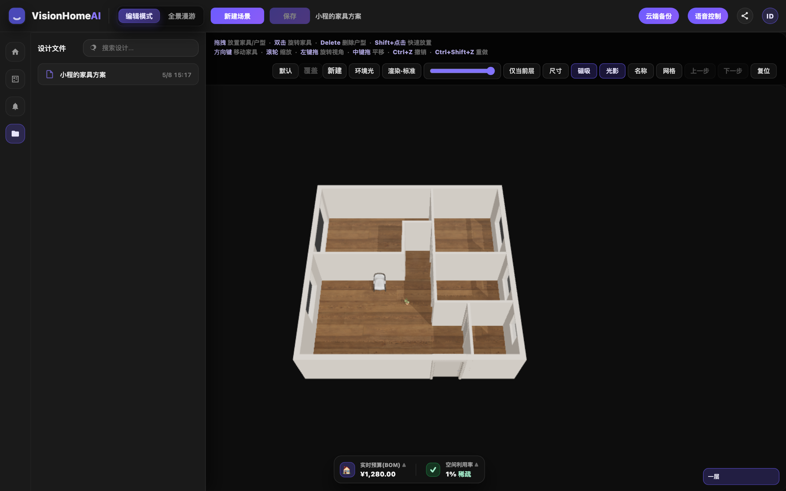
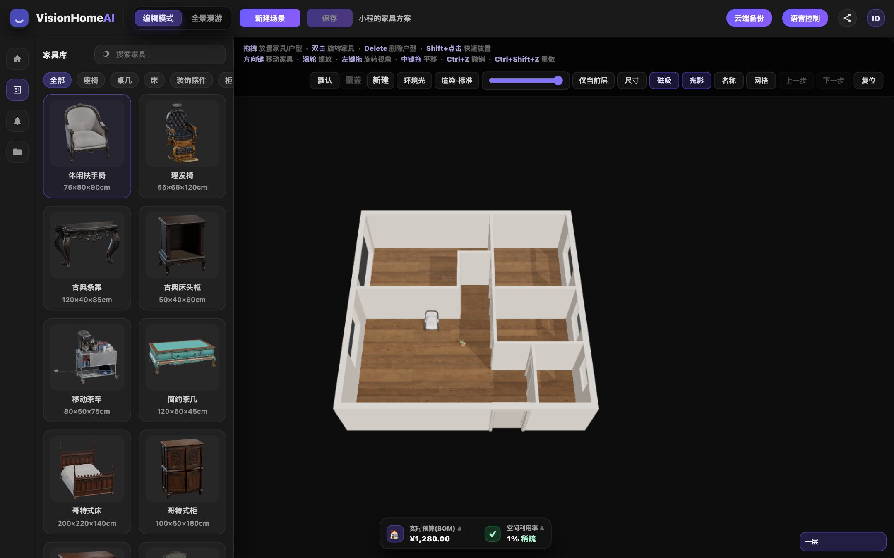
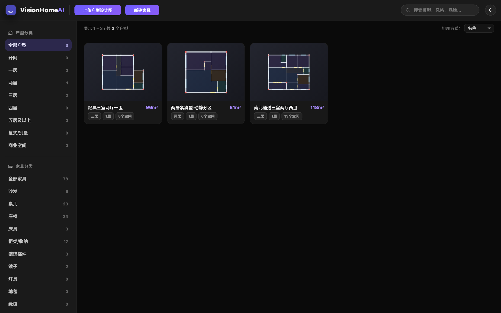

# VisionHomeAI

基于 **Three.js** 的本地家居设计工作台：从户型库选择户型，在 3D 场景中摆放家具与装饰，实时查看预算与空间利用率，并把方案保存回项目目录。

项目是**纯前端 ES Module + Python 本地开发服务**，无需 npm / 构建步骤，克隆后即可运行。

## 界面预览

### 3D 编辑模式

在 3D 户型中拖拽家具、调节风格与环境光，底部实时显示预算（BOM）和空间利用率。



### 家具与装饰资产库

内置 78 件家具资产与独立装饰库，支持分类筛选、搜索、拖动放置和 Shift 快速放置。



### 用户资产页

`user.html` 提供户型与家具的分类浏览、搜索、排序与分页。



## 功能特性

- **3D 户型编辑**：户型拖入画布后按真实尺寸建模，支持墙体磁吸、尺寸标注、楼层切换、网格/阴影/名称标注开关。
- **家具与装饰**：家具库、装饰库卡片可直接拖入 3D 场景；支持双击旋转、方向键微调、Delete 删除、Shift+点击快速放置。
- **编辑体验**：撤销/重做（`Ctrl+Z` / `Ctrl+Shift+Z`）、视图复位、仅显示当前楼层、其他楼层透明度调节。
- **装饰风格包**：为每个户型维护多套风格（墙面、地面、门窗样式等），支持覆盖当前风格或另存为新风格。
- **环境光与渲染质量**：曝光、环境光、半球光、平行光、环境贴图强度可调；提供标准 / 高精度 / 超清三档渲染质量。
- **实时预算与空间利用率**：底部面板汇总家具 BOM 总价和空间利用率，可点开查看明细。
- **属性面板**：查看家具尺寸（宽 × 深 × 高）、价格、标签等信息。
- **方案管理**：保存方案到 `assets/design/`、更新 manifest、切换/新建场景，离开页面再返回时保留当前编辑会话。
- **资产浏览页**：户型 / 家具分类统计、全文搜索、排序、分页。
- **本地保存接口**：`dev_server.py` 提供方案、户型与风格包的写入/删除 API。

## 技术栈

| 类别 | 说明 |
| --- | --- |
| 3D 渲染 | [Three.js](assets/vendor/three.module.js)（本地 vendor）+ OrbitControls + GLTFLoader |
| 前端 | 原生 HTML / CSS / JavaScript ES Modules，无框架、无打包器 |
| 3D 资产 | GLB 家具模型、贴图、户型装饰包 |
| 本地服务 | Python 标准库 `http.server` 扩展（静态文件 + JSON 保存 API） |

## 快速开始

### 环境要求

- Python 3.9+（仅用于本地静态服务与保存接口）
- 支持 WebGL 与 ES Module 的现代浏览器（Chrome / Edge / Safari）

### 启动

**必须在项目根目录（包含 `index.html` 的目录）启动，并通过 `http://` 访问。**
直接双击 HTML（`file://`）会导致 ES Module 被浏览器拦截，页面无法交互。

```bash
cd /path/to/VisionHomeAI
python3 dev_server.py
```

启动后访问：

- 编辑器：<http://localhost:8080/index.html>
- 用户资产页：<http://localhost:8080/user.html>

默认端口为 `8080`，可通过环境变量修改：

```bash
PORT=3000 python3 dev_server.py
```

如果只需要浏览、不需要保存到仓库，也可以用纯静态服务：

```bash
python3 -m http.server 8080
```

此时“保存方案”会回退为下载 JSON 文件。

## 使用指南

### 编辑模式

1. 在左侧 **户型库** 选择户型：拖动卡片到 3D 画布，或 **Shift + 点击** 快速添加到中心。
2. 切换到 **家具库 / 装饰库**，把卡片拖入画布进行摆放。
3. 双击家具旋转；方向键移动；`Delete` 删除；`Ctrl+Z` / `Ctrl+Shift+Z` 撤销与重做。
4. 顶部工具栏可切换装饰风格、调节环境光、选择渲染质量、开关尺寸 / 磁吸 / 阴影 / 名称 / 网格。
5. 底部查看 **实时预算（BOM）** 与 **空间利用率**，点击可展开明细。
6. 点击 **保存** 将方案写入 `assets/design/`；点击 **新建场景** 开始空方案。

### 底部面板

- **实时预算（BOM）**：按家具单价汇总当前方案总价。
- **空间利用率**：根据已摆放家具占地面积与户型面积计算，并给出利用率等级。

### 用户资产页

`user.html` 汇总展示户型与家具资产，支持按分类筛选、搜索、排序和分页，并可跳回编辑器。

## 目录结构

```text
VisionHomeAI/
├── assets/
│   ├── floorplans/          # 户型库：manifest.json + 各 <id>.json
│   │   ├── style/           # 户型装饰包：<id>.json + textures/
│   │   └── manifest.json
│   ├── furniture/           # 家具库：furnitureLibrary.json（items 列表）
│   │   ├── models/          # GLB 家具模型
│   │   └── thumbnails/      # 家具卡片预览图
│   ├── decorations/         # 装饰库：decorations.json + models/ + thumbnails/
│   ├── design/              # 用户方案：<id>.json + manifest.json
│   ├── vendor/              # three.js、OrbitControls、GLTFLoader 等本地依赖
│   └── textures/            # 通用贴图
├── src/
│   ├── core/                # 路径与 schema、manifest 多文件加载、应用外壳
│   ├── editor3d/            # Three.js 编辑器、渲染器、全景视口、功能模块
│   ├── floorplan/           # 户型库加载、SVG 平面图、门窗样式、装饰包
│   ├── furniture/           # 家具库、碰撞 / 磁吸、家具样式
│   ├── decorations/         # 装饰库加载与侧栏
│   ├── files/               # 设计文件清单、保存流程
│   ├── ui/                  # 颜色选择器等 UI 组件
│   ├── utils/               # 几何与数学工具
│   ├── main.js              # 应用入口
│   └── userPage.js          # 用户资产页入口
├── docs/screenshots/        # README 截图
├── dev_server.py            # 本地开发服务器（静态资源 + 保存 API）
├── index.html               # 3D 编辑器
├── user.html                # 用户资产页
└── styles.css               # 全局样式
```

## 数据说明

### 户型库

- 入口为 `assets/floorplans/manifest.json` 的 `files`，每个文件名对应同目录下的 `<id>.json`。
- 工程中的 `templateId` / `floorPlanId` 对应户型 JSON 里的 `id`。
- 户型 JSON 可在 `project.category` 配置中文分类（如 `两居`、`三居`），用于侧栏分类 Tab。
- 新增户型：在 `assets/floorplans/` 增加 `<id>.json`，并把文件名写入 manifest。

### 家具库与装饰库

- 家具库为单文件 `assets/furniture/furnitureLibrary.json`，`items` 数组中的每一项包含 `id`、`name`、`category`、`model`、`thumbnail`、`price` 等字段。
- 家具卡片预览仅在配置了 `thumbnail` 时加载图片，否则显示骨架占位；平面图中的 `data-model` 对应家具 `id`。
- 装饰库为 `assets/decorations/decorations.json`，模型与缩略图分别位于 `models/`、`thumbnails/`。
- 家具模型使用 GLB 格式，放在 `assets/furniture/models/`。

### 设计文件（方案）

`assets/design/*.json` 表示在某个户型模板上的**布局编辑会话**，不重复存整套户型几何。

- `schemaVersion`：当前为 `"1.1"`。
- `templateId`：对应 `assets/floorplans/<id>.json` 中的 `id`。
- `layoutEditor`（`version: 1`）：`floorPlanId`、`floorLevelIndex`、`floorplanStyleKey`、`furniture`（`instanceId` / `model` / `floorId` / `x` / `y` / `rotation`）、`surfaceOverridesByStyleKey`、`lightingConfig`、`renderQualityMode`。
- `floorplanSnapshot`：可选，用于保存墙线等覆盖（当前可为 `null`）。
- 未选户型时 `templateId` / `layoutEditor.floorPlanId` 可为 `null`（空方案）。
- 侧栏列表读取 `assets/design/manifest.json` 的 `files`，再请求对应 JSON。
- 每条方案必须有唯一 `id`，**文件名必须为 `<id>.json`** 且与 manifest 一致；`name` 用于侧栏展示。
- 示例：`assets/design/project_1777337990181.json`（绑定 `apt_2b1l_compact_01`，含示例家具）。

### 户型装饰包

- 路径为 `assets/floorplans/style/<floorplanId>.json`，可包含多套 `styles`。
- 贴图位于 `assets/floorplans/style/textures/`。
- 通过编辑器顶部的 **风格 / 覆盖 / 新建** 管理。

## 本地保存 API

`dev_server.py` 在静态文件服务之外提供以下同源 POST 接口：

| 接口 | 作用 |
| --- | --- |
| `POST /api/design/save` | 保存方案 JSON 到 `assets/design/`，并维护 `manifest.json` |
| `POST /api/design/delete` | 删除方案并更新 manifest |
| `POST /api/floorplan/save` | 保存户型 JSON 到 `assets/floorplans/`，并维护 manifest |
| `POST /api/floorplan/delete` | 删除户型及对应装饰包 |
| `POST /api/floorplan-style/save` | 保存户型装饰包到 `assets/floorplans/style/<floorplanId>.json` |

使用 `python3 -m http.server` 时这些接口不可用，保存操作会退化为下载 JSON。

## 常见问题

**页面打开后没有交互 / 控制台没有脚本日志？**

请确认通过 `http://` 访问，而不是 `file://`。ES Module 在 `file://` 下会被浏览器阻止。

**3D 区域是黑的？**

- 确认浏览器已启用 WebGL（可访问 `chrome://gpu` 检查）。
- 确认已加载方案或已把户型拖入画布；仅选中卡片不会生成 3D 户型。
- 无头浏览器或远程桌面环境可能需要启用软件渲染。

**保存失败？**

- 确认使用的是 `python3 dev_server.py`，而不是纯静态服务。
- 检查 `assets/design/`、`assets/floorplans/` 是否具有写权限。

## 开发约定

- 所有数据请求使用相对路径，避免部署到子路径时失效。
- 新增资产时同步更新对应 `manifest.json` / 列表 JSON，并在页面中确认卡片可正常加载。
- 不需要构建步骤；修改 `src/` 或 `styles.css` 后刷新浏览器即可生效。
